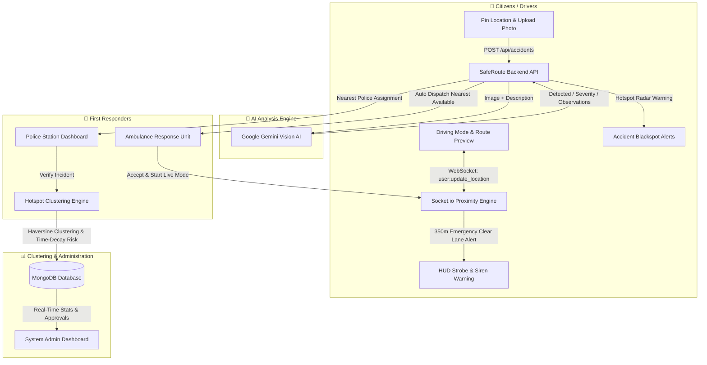

# 🚨 SafeRoute

> **Next-Generation Real-Time Accident Reporting, Navigation Safety, and Autonomous Emergency Response System**

[](https://nodejs.org/)
[](https://expressjs.com/)
[](https://www.mongodb.com/)
[](https://socket.io/)
[](https://ai.google.dev/)
[](https://tailwindcss.com/)
[](https://opensource.org/licenses/ISC)

---

## 📌 Executive Summary

Every year, millions of road accidents occur worldwide. Crucial minutes lost during the **"Golden Hour"** (the critical 60-minute window following traumatic injury) often mark the boundary between survival and tragedy. Existing reporting mechanisms rely on frantic phone calls with poor geolocation, delayed dispatch, and uncoordinated traffic clearance.

**SafeRoute** transforms incident response into an intelligent, interconnected ecosystem connecting **Citizens**, **Emergency Paramedics**, **Traffic Police**, and **System Administrators** in real time:

- 📷 **Instant Multi-Modal Reporting**: One-tap GPS accident pinning and photographic evidence capture.
- 🤖 **Computer Vision & AI Verification**: Real-time validation, severity classification, and scene observation using **Google Gemini AI**.
- 🚑 **Automated Nearest Dispatch & Emergency Corridor**: Automatic proximity-based ambulance assignment and live GPS telemetry.
- 🚨 **350m Clear-Lane Audio-Visual Strobe**: Dynamic proximity radar that broadcasts instant alerts and siren audio to nearby motorists on the road, prompting them to yield before the ambulance arrives.
- ⚠️ **Autonomous Hotspot Engine**: Intelligent spatial clustering and time-decay risk modeling that proactively alerts drivers when approaching high-risk accident blackspots.
- 💾 **Zero-Friction Zero-Config Database**: Intelligent MongoDB bootstrapper featuring embedded in-memory database fallback (`mongodb-memory-server`) with on-disk persistence and automated seed accounts.

---

## 🏗️ Architecture & Workflow



---

## 🌟 Key Features

### 1. 🚶 Citizen & Driver Portal
- **Interactive Google Maps Interface**: Dynamic map rendered with dark-mode styling, real-time geolocation tracking, and custom markers.
- **1-Click Accident Reporting**: Pin exact coordinates via map click or device GPS, select accident category (Collision, Vehicle crash, Pedestrian, Motorcycle), rate initial severity, and upload photographic evidence.
- **Turn-by-Turn Driving Mode**: Search destinations with Google Places Autocomplete, view route distance/ETA, and navigate with live GPS positioning.
- **Accident Blackspot Proximity Alerts**: Real-time HUD banner displays distance, accident count, and risk tier when nearing hazardous hotspots.
- **🚨 350m "Clear the Lane" Emergency Alert**: When an ambulance in transit approaches within 350 meters, the driver's interface triggers an animated emergency strobe, directional countdown, and audible siren prompt to pull over.
- **Incident History**: Citizens can view previous reports and monitor live verification statuses (`PENDING`, `VERIFIED`, `REJECTED`).

### 2. 🤖 Gemini Multimodal AI Integration
- Evaluates incident photos against citizen descriptions.
- Determines whether the scene contains vehicle damage or road hazards (`detected: true/false`).
- Classifies severity (`Minor`, `Moderate`, `Severe`, `Unknown`) with a confidence metric (0.0 to 1.0).
- Produces objective damage observations to eliminate triage bottlenecks before responders arrive.
- Resilient architecture with OpenAI fallback and non-blocking background evaluation.

### 3. 🚓 Police Control Room
- **Automated Precinct Routing**: Reports are dispatched to the closest approved police station using Haversine spherical distance.
- **Live Dispatch Feed**: Instant real-time alerts (`accident:new`) pushed directly to the station dashboard.
- **Evidence Review & Triage**: Inspect high-resolution damage photos alongside AI confidence ratings and scene observations.
- **Verification Workflow**: Officers confirm or reject reports, instantly triggering the downstream hotspot clustering algorithm and ambulance coordination.

### 4. 🚑 Paramedic & Emergency Ambulance Dashboard
- **Automated Nearest Dispatch**: When the AI confirms an incident, the system queries available ambulances and alerts the closest unit.
- **Emergency Dispatch Actions**: Accept, decline, or complete calls with live status progression (`SENT` ➔ `ACCEPTED` ➔ `COMPLETED`).
- **Live Emergency Transit Mode**: Paramedics toggle live transit mode to stream continuous GPS coordinates, speed, and heading.
- **Real-Time Corridor Telemetry**: Shows live counter of motorists currently alerted within the vehicle's 350-meter safety zone.

### 5. 🎯 Autonomous Hotspot Engine & Dynamic Risk Modeling
- **Spatial Clustering**: Automatically clusters verified accidents within a configurable radius ($\epsilon = 35\text{m} - 50\text{m}$) and recalculates geometric centroid centers.
- **Time-Decay Risk Formulation**:
  $$\text{Score} = \sum_{i} \left( W_{\text{severity}}(i) \times e^{-\frac{\Delta t_i}{\tau}} \right)$$
  - Weights: `Severe = 3.0`, `Moderate = 2.0`, `Minor = 1.0`
  - Decay Window: Half-life calculated over 180 days ($\tau = 180$)
  - Risk Tiers: `LOW` (<5), `MODERATE` (5–9), `HIGH` (10–19), `CRITICAL` (≥20)
- **Live Broadcast**: Pushes updated clusters (`hotspot:updated`) to all active navigation maps.

### 6. 🛡️ Administrator Operations Center
- Platform metrics: Total registered citizens, active police stations, certified ambulances, pending/verified incidents, and hotspot counts.
- Institutional verification: Review and approve/reject newly registered police stations and ambulance vehicles.
- Complete system audit log and incident monitoring.

---

## 🛠️ Technology Stack

| Layer | Technologies |
| :--- | :--- |
| **Backend Runtime** | [Node.js](https://nodejs.org/) (CommonJS) |
| **Web Framework** | [Express.js v5](https://expressjs.com/) |
| **Real-Time WebSockets** | [Socket.io v4](https://socket.io/) (Handshake JWT Auth, Room-based channels) |
| **Database & ODM** | [MongoDB](https://www.mongodb.com/) & [Mongoose v9](https://mongoosejs.com/) |
| **Zero-Config DB Fallback** | [mongodb-memory-server](https://github.com/nodkz/mongodb-memory-server) (Persistent local disk storage) |
| **Artificial Intelligence** | [Google Generative AI](https://ai.google.dev/) (`gemini-3.1-flash-lite`), [OpenAI](https://openai.com/) |
| **Frontend UI** | HTML5, Modern ES6+ JavaScript, [Tailwind CSS](https://tailwindcss.com/) (CDN) |
| **Icons & Typography** | [Phosphor Icons](https://phosphoricons.com/), JetBrains Mono, Outfit |
| **Mapping & Location** | [Google Maps JavaScript API](https://developers.google.com/maps) (Places Autocomplete, Directions, Markers) |
| **Security & Auth** | JSON Web Tokens (JWT), Bcrypt.js (10 salt rounds), Helmet, CORS |
| **File Storage** | Multer disk storage (`uploads/accidents`) |

---

## 📂 Project Directory Structure

```text
SafeRoute/
├── backend/
│   ├── data/
│   │   └── db/                      # Persistent storage for embedded MongoDB
│   ├── src/
│   │   ├── config/
│   │   │   └── db.js                # Mongo connection + embedded fallback + seeding
│   │   ├── controllers/
│   │   │   ├── accidentController.js# Accident submission, AI hook, nearest station/ambulance
│   │   │   ├── adminController.js   # Analytics, user listings, approval management
│   │   │   ├── ambulanceController.js # Live transit mode, emergency accept/decline
│   │   │   └── authController.js    # Multi-role authentication & registration
│   │   ├── middleware/
│   │   │   ├── authMiddleware.js    # JWT verification
│   │   │   ├── roleMiddleware.js    # Role-based access control (RBAC)
│   │   │   └── uploadMiddleware.js  # Multer image storage validation
│   │   ├── models/
│   │   │   ├── Accident.js          # Accident schema & AI analysis subdocument
│   │   │   ├── Hotspot.js           # Clustered hotspot schema & risk scores
│   │   │   └── User.js              # Polymorphic user schema (User, Police, Ambulance, Admin)
│   │   ├── routes/
│   │   │   ├── accidentRoutes.js    # /api/accidents
│   │   │   ├── adminRoutes.js       # /api/admin
│   │   │   ├── ambulanceRoutes.js   # /api/ambulance
│   │   │   └── authRoutes.js        # /api/auth
│   │   ├── routes/
│   │   │   └── hotspotRoutes.js     # /api/hotspots
│   │   ├── services/
│   │   │   ├── ai/
│   │   │   │   ├── aiService.js     # Unified AI orchestrator
│   │   │   │   ├── geminiProvider.js# Google Gemini multimodal vision analysis
│   │   │   │   └── openaiProvider.js# OpenAI fallback provider
│   │   │   └── hotspot/
│   │   │       ├── clusteringService.js # Haversine spatial calculations & centroid math
│   │   │       ├── hotspotService.js    # Hotspot creation & update pipeline
│   │   │       └── riskService.js       # Severity weights & time-decay scoring
│   │   ├── sockets/
│   │   │   └── socketManager.js     # Real-time WebSocket hubs & 350m proximity engine
│   │   ├── utils/
│   │   │   ├── distance.js          # Haversine distance utilities (km & meters)
│   │   │   └── seedUsers.js         # Initial mock database seeders
│   │   ├── app.js                   # Express application setup, routes, static hosting
│   │   └── server.js                # Server entry point & graceful shutdown hooks
│   ├── uploads/
│   │   └── accidents/               # Uploaded accident evidence images
│   ├── .env.example                 # Environment configuration template
│   └── package.json                 # Backend dependencies & npm scripts
├── frontend/
│   ├── admin/
│   │   └── dashboard.html           # Administrator panel (approvals & telemetry)
│   ├── ambulance/
│   │   ├── dashboard.html           # Paramedic live emergency & transit dashboard
│   │   ├── login.html               # Ambulance login
│   │   └── register.html            # Ambulance unit registration
│   ├── police/
│   │   ├── dashboard.html           # Police precinct live triage & verification dashboard
│   │   ├── login.html               # Police station login
│   │   └── register.html            # Police station registration
│   ├── user/
│   │   ├── dashboard.html           # Citizen map, reporting, driving mode & 350m HUD
│   │   └── reports.html             # Citizen report tracking & history
│   ├── css/
│   │   ├── homepage.css             # Landing page aesthetics
│   │   └── style.css                # Global cyber/dark UI styles & strobe animations
│   ├── js/
│   │   ├── accidentSubmit.js        # Accident submission handler
│   │   ├── ambulanceDashboard.js    # Ambulance live-mode and dispatch UI logic
│   │   ├── api.js                   # Authenticated fetch wrapper
│   │   ├── auth.js                  # Client auth state management
│   │   ├── clearLaneAlert.js        # 350m proximity clear-lane audio-visual alert engine
│   │   ├── config.js                # Google Maps client configuration
│   │   ├── drivingMode.js           # Driving mode navigation & route renderer
│   │   ├── hotspotWarning.js        # Proximity blackspot alerts
│   │   ├── map.js                   # Core Google Map initialization & markers
│   │   └── policeDashboard.js       # Police live triage socket client
│   ├── account-type.html            # Role selection portal
│   ├── index.html                   # High-tech product landing page
│   ├── login.html                   # Unified login page
│   └── register.html                # Citizen registration page
└── README.md                        # Documentation
```

---

## ⚡ Quick Start Guide

### Prerequisites
- [Node.js](https://nodejs.org/) (v18.0.0 or higher recommended)
- [npm](https://www.npmjs.com/) (bundled with Node.js)
- *(Optional)* [MongoDB Community Server](https://www.mongodb.com/try/download/community) — **Not strictly required!** If local MongoDB is not running, SafeRoute automatically spins up a persistent embedded database.

---

### Step 1: Navigate to Backend Directory

```bash
cd backend
```

### Step 2: Install Dependencies

```bash
npm install
```

### Step 3: Configure Environment Variables

Create a `.env` file in `backend/` based on `.env.example`:

```bash
cp .env.example .env
```

Open `.env` and fill in your settings:

```env
PORT=3000
MONGODB_URI=mongodb://127.0.0.1:27017/saferoute
JWT_SECRET=saferoute_super_secret_jwt_key_2026

# Google Gemini API (Required for image analysis)
GEMINI_API_KEY=YOUR_GEMINI_API_KEY
GEMINI_MODEL=gemini-3.1-flash-lite

# Hotspot & Alert Thresholds
HOTSPOT_CLUSTER_RADIUS_METERS=50
HOTSPOT_EPSILON_METERS=35
AMBULANCE_ALERT_DISTANCE=500
```

> 💡 **Tip**: Get a free Google Gemini API key at [Google AI Studio](https://aistudio.google.com/).

### Step 4: Configure Google Maps (Frontend)

Open `frontend/js/config.js` and verify or set your Google Maps JavaScript API key:

```javascript
const SafeRouteConfig = {
    GOOGLE_MAPS_API_KEY: 'YOUR_GOOGLE_MAPS_API_KEY'
};
```
*Ensure `Maps JavaScript API` and `Places API` are enabled in your Google Cloud Console.*

### Step 5: Start the Server

```bash
# Production start
npm start

# Or development mode with auto-reload
npm run dev
```

You will see server startup logs similar to:
```text
[Database] Attempting connection to: mongodb://127.0.0.1:27017/saferoute
[Database] Connected successfully to external/running MongoDB.
SafeRoute running on http://localhost:3000
```
*(If no local MongoDB service is running, it will automatically launch the embedded Mongo memory engine with persistent storage at `backend/data/db`).*

### Step 6: Access the Application

Open your browser and navigate to:
👉 **`http://localhost:3000`**

---

## 🔑 Default Seeded Demo Accounts

On initial startup, SafeRoute automatically seeds the database with pre-configured accounts:

| Role | Email | Password | Details |
| :--- | :--- | :--- | :--- |
| **Administrator** | `admin@saferoute.com` | `password123` | System oversight & portal management |
| **Police Station** | `police@saferoute.com` | `password123` | Central Police Station, Bengaluru |
| **Ambulance Unit** | `ambulance@saferoute.com` | `password123` | Victoria Hospital Emergency Unit (KA-01-EQ-9999) |
| **Citizen User** | `user@saferoute.com` | `password123` | Demo Citizen Driver |

---

## 📡 REST API Reference

### 🔐 Authentication (`/api/auth`)
| Method | Endpoint | Access | Description |
| :--- | :--- | :--- | :--- |
| `POST` | `/api/auth/register` | Public | Register standard Citizen user |
| `POST` | `/api/auth/register-police` | Public | Register Police precinct (pending admin approval) |
| `POST` | `/api/auth/register-ambulance` | Public | Register Ambulance unit (pending admin approval) |
| `POST` | `/api/auth/login` | Public | Authenticate user & return JWT token |
| `GET` | `/api/auth/me` | Authenticated | Get current logged-in user profile |
| `PATCH`| `/api/auth/location` | Authenticated | Update user's current GPS coordinates |

### 💥 Accidents (`/api/accidents`)
| Method | Endpoint | Access | Description |
| :--- | :--- | :--- | :--- |
| `POST` | `/api/accidents` | Citizen (`USER`) | Submit accident with image, coordinates & description |
| `GET` | `/api/accidents/my` | Citizen (`USER`) | Retrieve caller's submitted accident history |
| `GET` | `/api/accidents/pending` | `POLICE`, `ADMIN` | Fetch pending accidents assigned to the station |
| `PATCH`| `/api/accidents/:id/status` | `POLICE` | Verify or reject accident report (`VERIFIED`/`REJECTED`) |

### 🚑 Ambulance Operations (`/api/ambulance`)
| Method | Endpoint | Access | Description |
| :--- | :--- | :--- | :--- |
| `PATCH`| `/api/ambulance/live-mode` | `AMBULANCE` | Toggle live emergency transit mode (`isLive: true/false`) |
| `PATCH`| `/api/ambulance/live-location`| `AMBULANCE` | Stream live GPS telemetry (lat, lng, speed, heading) |
| `GET` | `/api/ambulance/live-status` | `AMBULANCE` | Retrieve active transit status & alerted user count |
| `GET` | `/api/ambulance/emergencies` | `AMBULANCE` | Retrieve pending & accepted emergencies |
| `PATCH`| `/api/ambulance/emergencies/:id/accept` | `AMBULANCE` | Accept emergency response call |
| `PATCH`| `/api/ambulance/emergencies/:id/decline`| `AMBULANCE` | Decline emergency response call |
| `PATCH`| `/api/ambulance/emergencies/:id/complete`| `AMBULANCE` | Mark emergency incident resolved |

### 🎯 Hotspots (`/api/hotspots`)
| Method | Endpoint | Access | Description |
| :--- | :--- | :--- | :--- |
| `GET` | `/api/hotspots` | Authenticated | Fetch all computed accident blackspots with risk ratings |

### 🛡️ Administration (`/api/admin`)
| Method | Endpoint | Access | Description |
| :--- | :--- | :--- | :--- |
| `GET` | `/api/admin/stats` | `ADMIN` | Retrieve aggregate platform analytics |
| `GET` | `/api/admin/users` | `ADMIN` | List all users, police stations, and ambulances |
| `GET` | `/api/admin/accidents` | `ADMIN` | List all incidents across the platform |
| `PATCH`| `/api/admin/users/:id/approval`| `ADMIN` | Approve or reject institutional registration |

---

## ⚡ Real-Time Socket.io Events

Socket connections require a JWT token passed during the connection handshake:
```javascript
const socket = io({ auth: { token: localStorage.getItem('token') } });
```

### Server ➔ Client Broadcasts
| Event Name | Target Room | Payload | Purpose |
| :--- | :--- | :--- | :--- |
| `accident:new` | `police:<stationId>` | Accident object | Notifies assigned police precinct of incoming accident |
| `ambulance:new_emergency` | `ambulance:<ambId>` | Emergency object | Alerts nearest ambulance to accept dispatched incident |
| `ambulance:clear_lane_alert` | Active users within 350m | Vehicle details, distance, ETA | Triggers urgent clear-lane HUD strobe & siren |
| `ambulance:clear_lane_cleared`| Alerted users | Ambulance ID | Dismisses clear-lane warning when ambulance departs |
| `ambulance:nearby_users_count` | `ambulance:<ambId>` | `{ count: N, radiusMeters: 350 }` | Informs ambulance how many drivers have cleared lane |
| `hotspot:updated` | All connected clients | Hotspot object | Broadcasts newly clustered or recalculated blackspot |

### Client ➔ Server Submissions
| Event Name | Source | Description |
| :--- | :--- | :--- |
| `user:update_location` | Citizen / Driver | Streams continuous driving coordinates to the proximity engine |
| `user:stop_tracking` | Citizen / Driver | Stops tracking citizen location on navigation termination |
| `ambulance:toggle_live_mode` | Ambulance Unit | Starts or stops live emergency response broadcast |
| `ambulance:update_location` | Ambulance Unit | Streams high-frequency live GPS telemetry while in transit |

---

## 🧪 Testing the Live Emergency Flow

To test the end-to-end emergency loop locally:

1. **Open Citizen Dashboard**:
   - Open a browser window at `http://localhost:3000/login.html` and sign in as `user@saferoute.com` / `password123`.
   - Click **"Update My Location"** or **"Start Driving"** to register your live position with the backend.
2. **Open Ambulance Dashboard**:
   - In an incognito window, sign in as `ambulance@saferoute.com` / `password123`.
   - In the Ambulance Dashboard, click **"GO LIVE (EMERGENCY MODE)"**.
3. **Simulate Approaching Ambulance**:
   - Adjust coordinates or test movement within **350 meters** of the citizen's position.
   - Observe the **Urgent Clear Lane HUD Alert** and siren sound instantly trigger on the Citizen's screen!
   - Observe the real-time **"Motorists Alerted"** counter increment on the Ambulance screen.

---

## 🔒 Security Best Practices

- **Role-Based Access Control (RBAC)**: Fine-grained middleware ensures endpoints are restricted strictly to authorized roles (`USER`, `POLICE`, `AMBULANCE`, `ADMIN`).
- **Encrypted Password Storage**: All passwords hashed using `bcryptjs` with salt work factor 10.
- **JWT Protection**: Tokens signed with high-entropy keys, stored securely, and validated across both REST calls and WebSocket handshakes.
- **Input Sanitization & Bounds Checking**: Coordinate validation ensures values fall strictly within latitude $[-90, 90]$ and longitude $[-180, 180]$.
- **Upload Hardening**: Multer configured to validate image MIME types and prevent arbitrary code uploads.

---

## 📄 License

This project is licensed under the [ISC License](https://opensource.org/licenses/ISC).

---

<p align="center">
  <b>SafeRoute</b> — <i>Accelerating Emergency Response, Saving Lives One Second at a Time.</i>
</p>
